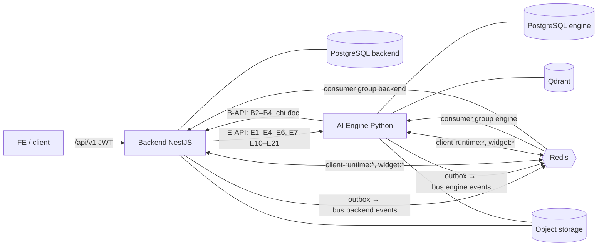

# Tách database & giao tiếp backend ↔ AI Engine

> Quyết định ngày 2026-11-20 (task DS-01, [nhật ký 021](journal/021-tach-database.md)). File này **thay** mô hình
> "một PostgreSQL dùng chung, mỗi bảng một bên ghi" của spec (§6, D9/D10, C1/C2 "Engine đọc bằng role read-only
> tới P5"). Chỗ nào spec/artifact nói khác thì theo file này, trừ các điểm còn chờ Hiếu quyết (mục 12, cuối file).
> Thuật ngữ và ký hiệu (E-API, B-API, C1–C22…): [glossary.md](glossary.md).
>
> Hợp đồng ở dạng code: [src/contracts/events/](../src/contracts/events/) (sự kiện),
> [src/contracts/backend/internal-api.ts](../src/contracts/backend/internal-api.ts) (B-API, Engine gọi backend),
> [src/contracts/engine/internal-api.ts](../src/contracts/engine/internal-api.ts) (E-API, backend gọi Engine).

## 1. Tóm tắt dễ hiểu

**Trước:** backend NestJS và Engine Python cùng mở một database. Engine đọc thẳng bảng `messages` để lấy lịch sử,
giải mã key trong `model_providers`, nối bảng `documents` khi tìm RAG. Backend thì ghi thẳng vào bảng tóm tắt của Engine.
Tiện, nhưng hai bên dính chặt: đổi một cột là phải sửa cả hai, không thể tách người làm, tách server hay nâng cấp riêng.

**Sau:** mỗi bên có **database riêng** và không bên nào được mở database của bên kia. Muốn có dữ liệu của bên kia thì
dùng một trong ba cách:

| Cách | Khi nào | Ví dụ |
|---|---|---|
| **Hỏi** — gọi API nội bộ | cần câu trả lời ngay để làm tiếp | Engine hỏi backend "cho tôi tin nhắn từ số 41 tới 60" |
| **Được báo** — sự kiện qua Redis Streams | chỉ cần bên kia biết và tự xử lý, trễ vài giây không sao | backend báo "hội thoại X đã xoá", Engine tự dọn bộ nhớ của X |
| **Được đưa kèm** — dữ liệu đi trong request | dữ liệu nhỏ, cần cho đúng một việc | mỗi lượt chat, backend gửi kèm persona, danh sách tài liệu, model + key |

Trạng thái tạm thời (hàng đợi lệnh gửi xuống thiết bị, widget) vẫn đi qua **key Redis dùng chung** như hiện nay.
File lớn đi qua **object storage**, hai bên trao nhau bằng `storageKey`.

## 2. Nguyên tắc

| # | Nguyên tắc |
|---|---|
| DS1 | Mỗi dịch vụ một database. User DB của bên này **không có quyền gì** (kể cả `SELECT`) trên DB bên kia. Dev có thể chung một server Postgres, nhưng khác database và khác user. |
| DS2 | Không FK chéo. Tham chiếu sang bên kia là cột UUID thường ("tham chiếu mềm"); toàn vẹn giữ bằng sự kiện xoá + dọn dẹp idempotent. |
| DS3 | Không transaction chéo. Thay đổi mà bên kia cần biết ⇒ **outbox trong cùng transaction** ⇒ relay ⇒ Redis Stream ⇒ consumer + **inbox** (giao ít nhất một lần, xử lý idempotent). |
| DS4 | Cần dữ liệu bên kia để trả lời ngay ⇒ API nội bộ đồng bộ: backend → Engine là **E-API**, Engine → backend là **B-API** (chỉ đọc). |
| DS5 | Một lượt chat mang theo mọi ngữ cảnh nhỏ (E1/E3/E4). Dữ liệu lớn — lịch sử tin nhắn — Engine tự kéo qua B2 theo con trỏ bộ nhớ của chính nó. |
| DS6 | Engine không ghi dữ liệu của backend. Thứ Engine tạo ra cho backend lưu (tin trả lời, ảnh, task plan, interrupt) đi trong sự kiện cuối của stream V3 (D6) hoặc trong event Engine → backend. |
| DS7 | Redis dùng chung là **kênh**, không phải kho chung: mỗi tiền tố key có đúng một chủ và có schema viết ra (§7). |
| DS8 | File qua object storage; DB chỉ giữ `storageKey`. Không còn thư mục dùng chung giữa hai tiến trình. |
| DS9 | Mỗi dữ liệu có đúng một nguồn sự thật. Bản sao (cache, cột chép lại) phải có sự kiện làm tươi và chịu được trễ. |

## 3. Ai sở hữu gì



| Kho | Chủ | Nội dung | Bên kia truy cập bằng |
|---|---|---|---|
| PostgreSQL **backend** | backend | 22 bảng nghiệp vụ + `refresh_tokens`, `outbox_events`, `inbox_events` ([database-schema.md](reference/database-schema.md)) | B-API (đọc), sự kiện |
| PostgreSQL **engine** | Engine | 11 bảng + 4 bảng checkpoint LangGraph | E-API (E10–E12), sự kiện |
| Qdrant | Engine | vector tài liệu | không |
| Redis | theo tiền tố key (§7) | stream sự kiện, hàng đợi thiết bị, widget, cache | theo §7 |
| Object storage | backend (bucket, vòng đời object) | file upload, ảnh chat, media Engine sinh ra, tool result lớn | `storageKey` |

Schema DB backend **từ giờ do migration NestJS làm chủ** (Alembic chỉ còn quản DB Engine). Bảng backend vẫn giữ
nguyên tên cột và tên ràng buộc như Alembic (công việc của SYNC-01) để chuyển dữ liệu một lần lúc cutover là sao
chép 1:1 (§10). Dọn dẹp các di sản như `messages.sender` là số hay tên `feedback_pkey` để sau cutover.

## 4. Chọn kênh nào

| Nhu cầu | Kênh | Ví dụ |
|---|---|---|
| Lệnh cần trả lời hoặc stream ngay | HTTP **E-API** | E1 lượt chat, E2 stop, E6 tiêu đề, E7 task plan, E13–E20 MCP |
| Engine cần ngữ cảnh cho một lượt | đi kèm request **E1/E3/E4** | persona, project instructions, `documents[]`, task plan, custom agent, HITL policy, `modelRuntime` |
| Engine cần dữ liệu backend ngoài lượt, hoặc dữ liệu lớn | HTTP **B-API** (chỉ đọc) | B2 tin nhắn, B3 tìm tin nhắn, B4 model + key |
| Backend cần dữ liệu Engine để trả FE | HTTP **E-API** | E10 tool result, E11/E12 usage |
| Báo thay đổi, dọn dẹp, việc nền | **sự kiện** Redis Streams | `conversation.deleted`, `document.uploaded`, `document.processing_status_changed` |
| Trạng thái tạm, độ trễ thấp, hàng đợi thiết bị | **key Redis dùng chung** | `client-runtime:*`, `widget:*` |
| File | **object storage** | upload tài liệu, ảnh chat, media sinh ra |

Mẹo chọn: bên gửi **cần câu trả lời** mới đi tiếp được ⇒ API. Bên gửi chỉ cần **bên kia biết rồi tự làm**, chậm vài
giây không sao ⇒ sự kiện.

## 5. API nội bộ

Chung: chỉ mạng nội bộ, gateway công khai không route `/internal/*`; `Authorization: Bearer <service token>` +
`X-Request-Id`. Mỗi chiều một token riêng: `AI_ENGINE_SERVICE_TOKEN` (backend → Engine), token Engine → backend (env
thêm ở INT-01).

### 5.1 E-API (backend → Engine) — đổi gì so với spec

Bảng đầy đủ ở [engine-contract.md](reference/engine-contract.md). Thay đổi do tách DB:

| # | Thay đổi | Thay cho |
|---|---|---|
| E1, E3, E4 | `modelRuntime` **bắt buộc**: model theo agent + key **đã giải mã** | C2 "giai đoạn P1: Engine tự giải mã Fernet" — làm luôn bản P5 |
| E1 | `history.throughSequence` thay `historyHint`; Engine kéo lịch sử qua B2 | C1 "Engine đọc `messages` bằng role read-only" |
| E1 | `documents[]` là **phạm vi RAG**: truy vấn chunk lọc theo các id này | C3/C4 nối bảng `documents`, `conversations` |
| E1 | `planning` có thêm `planLifecycle` (cùng `planningModeEnabled`, `tasks`) | Engine đọc `conversations.plan_lifecycle`, `task_plans` |
| E5, E8, E9 | **bỏ** ⇒ sự kiện `conversation.deleted`/`interrupt.expired`, `document.uploaded`, `document.deleted` | gọi HTTP từ bộ phát outbox |
| E11, E12 | chỉ trả **id** hội thoại; backend tự ghép tiêu đề, bỏ hội thoại đã xoá | `get_top_conversations` nối bảng `conversations` |

### 5.2 B-API (Engine → backend) — mới

Kiểu dữ liệu: [src/contracts/backend/internal-api.ts](../src/contracts/backend/internal-api.ts). Làm ở task INT-01.

| # | Method | Path | Dùng cho | Thay cho |
|---|---|---|---|---|
| ~~B1~~ | — | ~~POST /internal/v1/documents/{id}/status~~ | **bỏ** ⇒ event `document.processing_status_changed` | callback HTTP |
| B2 | GET | `/internal/v1/conversations/{id}/messages?ownerId&afterSequence&throughSequence&limit` | lịch sử prompt, job tóm tắt, memory hội thoại fork, request compaction, metadata assistant gần nhất, canvas | C1, C6, C18 |
| B3 | GET | `/internal/v1/users/{userId}/message-search?q&projectId&conversationId&limit` | tool tìm trong các hội thoại của user (dùng index FTS của backend) | `conversation_search` đọc `messages` |
| B4 | POST | `/internal/v1/model-runtime/resolve` | worker ngoài lượt cần model + key của user (tóm tắt) | C2 ở worker |

Luật B-API:
- `ownerId`/`userId` bắt buộc; dòng không thuộc user đó ⇒ 404 (D15). Hội thoại đã xoá ⇒ 404 — Engine dừng job của nó.
- Chỉ đọc. Engine muốn đổi dữ liệu backend ⇒ phát event.
- Timeout 5 s; Engine retry với backoff; backend chưa sẵn sàng thì job Engine thử lại sau, không ảnh hưởng lượt chat
  (lượt chat chỉ chạy khi backend đang gọi E1, tức là backend đang sống).
- B4 trả bí mật: `Cache-Control: no-store`, không log ở cả hai bên, Engine chỉ giữ trong RAM ≤ 5 phút.
- Còn thiếu (bổ sung ở INT-01, rà 25/11): tool `read_past_conversation` (C20) nhận **tiền tố** id hội thoại trong phạm
  vi user + project và trả tiêu đề, số tin nhắn; B2 hiện chỉ nhận id đầy đủ + `ownerId`.

## 6. Sự kiện qua Redis Streams

### 6.1 Vì sao Redis Streams (chờ Hiếu chốt)

- Hai bên **đã có Redis**: Python dùng làm broker Celery và hàng đợi thiết bị, backend cũng cần nó cho W5 ⇒ không
  thêm hạ tầng.
- Consumer group + `XACK` + `XAUTOCLAIM` đủ cho giao ít nhất một lần, nhiều consumer chia việc.
- Redis của Python đã bật AOF `appendfsync everysec`. Relay gọi `WAITAOF 1 0 <ms>` (Redis ≥ 7.2) sau `XADD`, rồi mới
  đánh dấu dòng outbox là `published` ⇒ Redis có sập cũng không mất event đã báo thành công.
- Nhược: không có DLQ hay hẹn giờ retry sẵn (tự làm bằng `:dlq` + `XAUTOCLAIM`); dữ liệu nằm trong RAM nên phải cắt
  stream; không có routing phức tạp. Nếu chọn **RabbitMQ**: hợp đồng sự kiện, outbox và port publisher (BUS-01)
  giữ nguyên, chỉ thay adapter.

### 6.2 Luồng một sự kiện

```mermaid
sequenceDiagram
  participant UC as Use case (backend)
  participant DB as DB backend
  participant RL as Relay (BUS-01)
  participant R as Redis bus:backend:events
  participant C as Consumer group "engine"
  participant EDB as DB engine
  UC->>DB: BEGIN; đổi dữ liệu; INSERT outbox_events; COMMIT
  RL->>DB: SELECT … FOR UPDATE SKIP LOCKED (pending, available_at ≤ now)
  RL->>R: XADD (type, event=JSON phong bì)
  RL->>R: WAITAOF 1 0 1000
  RL->>DB: status = published
  C->>R: XREADGROUP
  C->>EDB: BEGIN; INSERT inbox (event id) — trùng thì bỏ qua; xử lý; COMMIT
  C->>R: XACK
```

Chiều Engine → backend giống hệt: outbox của Engine ⇒ `bus:engine:events` ⇒ consumer group `backend` ⇒ bảng
`inbox_events` của backend (BUS-02).

### 6.3 Phong bì

Mỗi entry trong stream có 2 field: `type` (để lọc/đếm) và `event` (JSON của phong bì
[`IntegrationEventEnvelope`](../src/contracts/events/envelope.ts)):

```jsonc
{
  "id": "0b6c…",                       // = outbox_events.id; khoá chống trùng của bên nhận
  "type": "conversation.deleted",
  "version": 1,
  "producer": "backend",
  "occurredAt": "2026-11-20T03:12:44.120Z",
  "aggregate": { "type": "conversation", "id": "5f1e…" },
  "payload": { "conversationId": "5f1e…", "ownerId": "a2c4…", "threadIds": ["5f1e…"] },
  "requestId": "req-…"
}
```

### 6.4 Danh mục sự kiện

**Backend → Engine** (`bus:backend:events`, kiểu: [backend-events.ts](../src/contracts/events/backend-events.ts)):

| type | Ghi khi (task) | Engine làm gì | Thay cho |
|---|---|---|---|
| `conversation.deleted` | xoá hội thoại A12/A25 (CONV-02 ✅) | dừng lượt đang chạy của hội thoại, xoá thread checkpoint `threadIds`, bỏ summary/job/cache | E2 + E5; cascade |
| `conversation.forked` | fork A12a (CONV-03 ✅) | chuẩn bị memory cho con: tạo job tóm tắt của con tới `forkedThroughSequence`, đọc tin qua B2; **không** dùng summary của nguồn (như Python: nó có thể bao cả phần sau điểm cắt). Lượt đầu vẫn chờ tối đa 15 s như hiện nay | C17, C18 (ghi `conversation_summary_jobs` trong transaction fork) |
| `conversation.turn_persisted` | lưu xong tin nhắn của một lượt (GEN-04) | upsert job tóm tắt, làm tươi cache lịch sử | C6 (upsert job cùng transaction INSERT message) |
| `message.mutated` | sửa/xoá tin nhắn (hiện chưa có route nào gọi `update_message`/`delete_message`; để dành) | summary từ `sequence` trở đi hết hạn, mở lại job | C19 |
| `project.deleted` | xoá project PJ5 (PJ-05 ✅) | xoá mềm `user_memories` của project | C19 |
| `document.uploaded` | upload D1/D2 (DOC-01) | parse + index từ `storageKey`, phát `document.processing_status_changed` | E8; filesystem chung |
| `document.deleted` | xoá tài liệu D7 (DOC-03) | xoá chunk, ảnh, parse artifact, vector Qdrant | E9; cascade DB |
| `interrupt.expired` | quét interrupt hết hạn (SCH-01) và mọi đường khác chuyển interrupt sang `expired` (vd. Stop khi đang chờ duyệt), cùng transaction | xoá thread checkpoint của interrupt | E5; Celery quét `hitl_interrupts` |
| `generation.lease_expired` | lease reaper (SCH-01) | dừng run nếu còn chạy (như E2) | E2 từ outbox |

**Engine → backend** (`bus:engine:events`, kiểu: [engine-events.ts](../src/contracts/events/engine-events.ts)):

| type | Phát khi | Backend làm gì | Thay cho |
|---|---|---|---|
| `document.processing_status_changed` | bắt đầu / xong / lỗi parse + index | cập nhật `documents.status`: bỏ qua nếu `attemptId` cũ, không lùi trạng thái | callback B1; worker Python ghi thẳng `documents` |

Thêm loại xoá hay thay đổi mới mà bên kia giữ dữ liệu phụ thuộc ⇒ **phải** thêm event vào danh mục. Không còn cascade DB
nào làm hộ.

### 6.5 Đảm bảo giao nhận

| Vấn đề | Cách xử lý |
|---|---|
| Mất event giữa DB và Redis | outbox trong cùng transaction; relay chỉ đánh dấu `published` sau `XADD` + `WAITAOF` |
| Redis/Engine lỗi tạm thời | relay (poll 2 s) retry 5 s × 2ⁿ, giãn cách tối đa 10 phút, tối đa 12 lần rồi `failed` + cảnh báo; admin retry ở OBX-03 |
| Giao trùng | bảng inbox (`event_id` khoá chính) ghi **cùng transaction** với xử lý; handler "đặt trạng thái" chứ không "cộng dồn" |
| Consumer chết giữa chừng | entry chưa `XACK` > 60 s ⇒ consumer khác `XAUTOCLAIM` |
| Event độc (lỗi mãi) | giao > 10 lần ⇒ chuyển sang `<stream>:dlq`, ACK bản gốc, cảnh báo |
| Sai thứ tự | không đảm bảo thứ tự theo aggregate. Luật: xoá là trạng thái cuối; trạng thái có hàng rào (`attemptId`, `sequence`, `version`); làm mất hiệu lực theo `min(sequence)` |
| Stream phình | `XADD … MINID ~ <now − 7 ngày>`; outbox giữ dòng `published` ≥ 7 ngày để phát lại theo khoảng thời gian |
| Đổi schema payload | thêm field ⇒ giữ `version`; đổi nghĩa/bỏ field ⇒ `version` mới, bên phát phát cả hai bản trong giai đoạn chuyển |
| Quan sát | metric: lag (`XPENDING`), số entry DLQ, tuổi dòng outbox `pending` cũ nhất; `/health/dependencies` báo Redis bus |

## 7. Key Redis dùng chung

| Tiền tố | Chủ (ghi) | Bên đọc | Ghi chú |
|---|---|---|---|
| `bus:backend:events`, `bus:engine:events`, `…:dlq` | bên phát tương ứng | consumer group bên kia | §6 |
| `client-runtime:*` | backend: phiên, thiết bị (W5); Engine: đẩy request, đọc kết quả | cả hai | schema **đóng băng** (D7, C12, C13) |
| `widget:*`, `widget_session:*` | Engine (MCP widget server) | backend WS (W5) | C14 |
| `interrupt:<conversationId>:<interruptId>` | backend (HITL thuộc backend từ W4) | — | trước đây MessageService của Python |
| `generation:stop` (pub/sub) | Engine nội bộ | — | E2 đổ vào đây |
| `rag:*`, `model_usage:*` | Engine nội bộ | — | |
| `be:*` | backend nội bộ (cache, rate limit) | — | |

Luật: không đọc key nội bộ của bên kia. Key dùng chung có schema trong `src/contracts/` (thêm ở RDS-01).

## 8. Từng chỗ Python đang chạm DB của bên kia ⇒ cách mới

Kiểm kê từ code chatbot `80d9bc9b` ([nhật ký 021](journal/021-tach-database.md) có dẫn chứng file:dòng). Số C theo
spec §3.1.

| # | Hiện nay (Python) | Sau khi tách |
|---|---|---|
| C1 | History provider đọc `messages` sau con trỏ memory | B2 tới `history.throughSequence` của E1 |
| — | Metadata assistant gần nhất (routing), ứng viên canvas | B2 (metadata nguyên bản) |
| C2 | Giải mã `model_providers` bằng Fernet; đọc `agent_model_configs`, `server_secrets` (còn **insert** khoá nếu thiếu) | `modelRuntime` trong E1/E3/E4; B4 cho worker. Engine bỏ Fernet và `server_secrets` |
| C3 | RAG nối `documents` + `conversations` vào mọi truy vấn chunk/ảnh | lọc theo `documents[]` của E1; chunk tự lưu `documentId`/`ownerId` (lấy từ `document.uploaded`) |
| C4 | Routing đọc danh sách `documents` | E1 `documents[]` |
| C5 | Tool user memory (bật mặc định) đọc `conversations.project_id` | E1 `projectId` |
| C20 | Tool tìm hội thoại (`search_past_conversations`, `read_past_conversation`): đọc `messages`, `conversations` (tiêu đề, project) | B3 tìm, B2 đọc; B2 phải thêm tra theo tiền tố id, tiêu đề, số tin (INT-01) |
| C6 | INSERT message ⇒ upsert `conversation_summary_jobs` cùng transaction | event `conversation.turn_persisted` |
| — | Worker tóm tắt đọc `messages` + giải mã key; backfill quét `messages`/`conversations` | B2 + B4; backfill dựa trên job của chính Engine |
| C9 | Ghi `chat_images`; đọc lại ảnh lịch sử | Engine chỉ upload object, backend ghi dòng từ sự kiện cuối (GEN-04); ảnh lịch sử lấy `storageKey` từ metadata B2 |
| C21 | Web research ghi `web_image_references` | như C9 |
| — | MessageService ghi `messages`, `generations`, `generation_commands`, `hitl_interrupts`, `tool_approvals`, `task_plans` | backend (W4) từ stream V3 (D1, D6) |
| C11 | Celery quét `hitl_interrupts`, `conversations` đã xoá, `messages` để dọn checkpoint | event `conversation.deleted` (`threadIds`), `interrupt.expired`; backend tự quét hết hạn (SCH-01) |
| C17, C18 | Fork ghi `conversation_summary_jobs`; chuẩn bị memory lượt đầu đọc `messages` + summary | event `conversation.forked`; Engine tạo job cho con tới `forkedThroughSequence` + B2, không dùng summary của nguồn |
| C22 | Request builder phía backend (`ProjectContextService`) đọc `user_memories` để chèn vào system prompt | E1 chỉ mang project instructions + `projectId`; Engine tự chèn memory |
| — | Truy vấn summary/job join `conversations` để kiểm owner (bảng summary không có cột owner) | Engine lưu `ownerId` lấy từ sự kiện (mọi payload đều có) |
| C19 | Xoá project ghi `user_memories`; sửa/xoá message làm mất hiệu lực summary | event `project.deleted`, `message.mutated` |
| — | Worker tài liệu ghi `documents.status`; quét tài liệu kẹt | event `document.processing_status_changed`; quét kẹt chuyển về backend (SCH-01). `documents` cần cột attempt hiện hành (DOC-01); quét kẹt đánh `failed` thì attempt đó thành cũ, event muộn bị bỏ qua |
| — | Kích hoạt index khoá `documents FOR UPDATE` | Engine rào bằng `attemptId` trong DB của mình; backend rào lại khi nhận event |
| — | Xoá tài liệu: cascade xoá chunk/ảnh/artifact, `model_usage_events.document_id` = NULL | event `document.deleted`; backend xoá object ngay sau commit, không chờ Engine |
| C10 | `model_usage_*` có FK tới `users`, `conversations`, `messages`, `documents` (lỗi `ModelUsageReferenceError`) | cột UUID thường; không còn kiểm tham chiếu |
| — | Usage "top conversations" nối `conversations`; context window đọc metadata `messages` | E11/E12 trả id, backend ghép tiêu đề; Engine tự lưu số liệu context khi ghi usage |
| — | Khoá lượt advisory dùng chung (MessageService + fork) | chỉ backend khoá (D3); Engine không khoá |
| — | Reaper khi khởi động sửa `generations`; sweeper `client_devices` | backend: lease reaper (SCH-01), W5 |
| — | Cache lịch sử, trạng thái deferred-tool bị xoá bằng lời gọi trực tiếp | Engine tự làm tươi khi nhận `conversation.deleted`, `message.mutated`, `conversation.turn_persisted` |
| — | Upload chuyển file cho worker qua đường dẫn đĩa chung | object storage (D8) |
| — | Health đọc bảng summary/usage | E21 do Engine tự báo |

## 9. Cái giá: nhất quán sau vài giây

- Giữa lúc backend commit và lúc Engine dọn dẹp có độ trễ vài giây (ví dụ hội thoại đã xoá nhưng checkpoint còn tới khi
  event được xử lý). FE không thấy, vì backend đã trả 404 ngay.
- Engine có thể nhận event về hội thoại nó chưa từng biết, hoặc đã xoá: bỏ qua là đúng.
- Engine gọi B2 cho hội thoại đã xoá ⇒ 404 ⇒ job dừng.
- Nghi mất event (Redis mất dữ liệu ngoài phạm vi `WAITAOF`, sự cố vận hành): phát lại outbox theo khoảng thời gian
  (OBX-03). Bên nhận idempotent nên phát lại thừa vô hại.

## 10. Chuyển dữ liệu lúc cutover (chờ Hiếu chốt)

Production hiện có **một** DB của hệ Python. Phương án đề xuất:

1. DB backend tạo bằng migration NestJS.
2. **ETL-01:** chép 22 bảng backend từ bản chụp DB cũ sang DB backend. Tên/kiểu cột giống hệt nên chép 1:1; thêm
   `users.role = 'user'`; `refresh_tokens`, `outbox_events`, `inbox_events` để trống. Kiểm số dòng + checksum từng bảng,
   diễn tập trên bản sao production.
3. DB Engine: phía Engine bỏ bảng backend và 20 FK chéo (danh sách ở [database-schema.md](reference/database-schema.md))
   bằng Alembic của họ, hoặc dựng DB mới chỉ có bảng Engine.
4. Cửa sổ cutover: dừng ghi ⇒ ETL lần cuối ⇒ gateway trỏ sang NestJS + Engine bản mới ⇒ smoke test ⇒ mở lại. Rollback:
   trỏ gateway về hệ cũ, DB cũ không bị đụng tới.

Hệ quả: **không đưa production lên từng đợt được nữa** (W1 trước, W4 sau), vì hệ Python cũ còn chạy lượt chat thì vẫn
cần đọc `users`, `messages`… trong DB của nó. W1–W6 vẫn lên staging lần lượt. Phương án khác: đưa lên từng đợt và
đồng bộ tạm DB backend ⇒ DB cũ (logical replication) cho tới đợt cuối. Cách này phức tạp, chỉ nên chọn nếu bắt buộc
phải ra production sớm.

## 11. Việc phía Engine phải làm (task này không sửa repo chatbot)

Checklist bàn giao (ENG-04):

1. Nối DB riêng; bỏ model và ORM relationship trỏ sang bảng backend (`Conversation.memory_summary`, `Document.chunks`,
   `User.usage_events`, …).
2. Alembic phía Engine: bỏ 20 FK chéo; bảng backend ra khỏi chuỗi migration của Engine.
3. History provider, routing, RAG, tool tìm hội thoại, tool user memory: dùng E1 + B2/B3.
4. ModelConfigService: dùng `modelRuntime`/B4; bỏ Fernet và `server_secrets`.
5. Consumer group `engine` trên `bus:backend:events` + bảng inbox; handler cho 9 event ở §6.4.
6. Outbox + relay ⇒ `bus:engine:events` (`document.processing_status_changed`).
7. Thôi ghi bảng backend: code AI/worker hiện ghi `chat_images`, `web_image_references`, `hitl_interrupts` (job dọn
   interrupt), `documents.status`, và `server_secrets` lúc worker khởi động ⇒ trả qua stream V3 hoặc event.
   (`messages`, `generations`, `tool_approvals`, `task_plans`, `client_devices` do code quản lý ghi, sang NestJS cùng code đó.)
   Bỏ chèn user memory ở request builder (C22): Engine tự chèn.
8. Upload và media qua object storage, bỏ thư mục dùng chung.
9. Celery beat: bỏ các job quét bảng backend (dọn checkpoint, quét tài liệu kẹt, backfill tóm tắt theo `messages`).
10. Không lấy advisory lock lượt.
11. Registry MCP server (chốt 26/11): chuyển từ file `app/ai/mcp_config.json` + bộ đếm `tools_generation` trong RAM
    sang bảng trong **DB Engine**, phát thay đổi qua Redis cho các replica Engine (rủi ro R28). Backend không có bảng MCP,
    chỉ chuyển tiếp E13–E20 với quyền admin (MCP-01).

## 12. Quyết định chờ Hiếu

Danh sách đầy đủ (cả việc ngoài phần tách DB) ở [PLAN](PLAN.md#việc-cần-hiếu-quyết).

| Cần quyết | Đang đề xuất | Hạn chót |
|---|---|---|
| Bus sự kiện: Redis Streams hay RabbitMQ | Redis Streams (mục 6.1) | trước BUS-01 |
| Cutover: một lần sau khi đủ W1–W6 (ETL) hay từng đợt + đồng bộ tạm | một lần (mục 10) | càng sớm càng tốt — quyết định thứ tự PLAN và hạn của các việc về token |
| Gửi key provider **đã giải mã** sang Engine (E1, B4) hay Engine giữ khoá Fernet | đã giải mã, qua mạng nội bộ có TLS | trước GEN-03 / PRV-01 |
| Ai làm checklist mục 11 phía Engine, và khi nào | — | trước khi ghép lượt chat (W4) với Engine thật |

Đã chốt 26/11: registry MCP server do Engine giữ trong DB Engine (mục 11, việc 11). Trước đó spec tự mâu thuẫn:
mục 1c.6 và rủi ro R28 đề xuất bảng do backend sở hữu, còn mục 2, mục 5 và rủi ro R9 để MCP ở Engine. Chọn phía
Engine vì khớp phần lớn spec và kế hoạch MCP-01 (backend chỉ chuyển tiếp), không thêm bảng cho backend.

## 13. Máy canh

- [src/app.entities.spec.ts](../src/app.entities.spec.ts): không Record nào map bảng Engine, không chuỗi SQL nào
  `FROM/JOIN/INTO/UPDATE` bảng Engine, mọi Record phải nằm trong danh sách bảng backend.
- Hợp đồng là code: đổi sự kiện/B-API ⇒ sửa `src/contracts/` và file này trước (AGENTS luật 4).
- Port `AiEngineClient` không còn method side effect: muốn báo Engine ⇒ `Outbox.enqueue` với payload kiểu theo hợp đồng.
